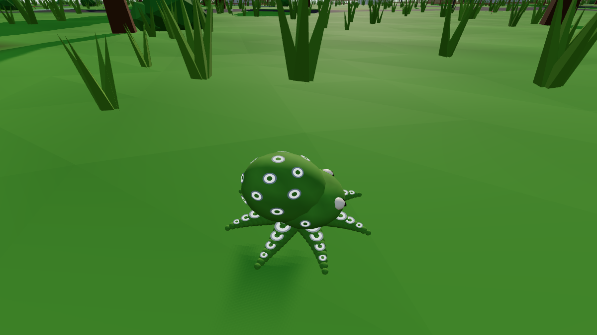

# 🐙 Octoventure

**Play now: https://metadata-team-member.github.io/Octoventure/**  (desktop browser, mouse + keyboard or a gamepad; click Play)

You are a tiny **Australian blue-ringed octopus** (*Hapalochlaena*), 20 cm long, stranded far inland and slowly drying out. The ocean is somewhere out there - **you are never told which way, and there is no compass** - and you have to find your way back across gardens, streets, farms, bush, creeks, wetlands, dunes and beaches, a world that towers over you. It is **one single world** for everybody, with every kind of country running into the next; each game simply begins somewhere else in it. There is no HUD, no timer and no tutorial: work it out as you play. Predators will notice you (your blue rings flash), and your defence is camouflage. Water is life. Everything else is for you to discover.

**Quick controls:** WASD move - mouse look - Shift sprint - Space camouflage (hold) - F ink (in water) - B / right-click venom - R climb - Esc pause. Full list below.




> Status: **playable prototype (v0.2)** - feedback welcome. No login, no server, no accounts, no data collected. All rights reserved (no licence granted yet).

## How to run it

### Option 1 – zero install (just double-click)
Open **`play/index.html`** in any modern browser (Chrome, Edge, Firefox, Safari). It is one self-contained file – no server, no Node, no internet needed.
* Windows: double-click **`Play.bat`** (or `play\index.html`). macOS/Linux: `./play.sh`.

### Option 2 – developer mode (live reload)
Needs [Node.js 18+](https://nodejs.org).
```bash
npm install
npm run dev          # opens http://localhost:5173
```
Windows shortcut: double-click **`Dev.bat`** (installs on first run, starts the server, opens the browser).

### Option 3 – Visual Studio / VS Code
* **Visual Studio 2022:** *File ▸ Open ▸ Folder…* and pick this folder. Open `package.json`, right-click it ▸ **Open npm Scripts** (or use *View ▸ Terminal*) and run `npm install`, then `npm run dev`. Browse to http://localhost:5173. (You can also just right-click `play/index.html` ▸ *Open With ▸ Browser*.)
* **VS Code:** *File ▸ Open Folder…*, then *Terminal ▸ Run Task…* ▸ **Run game (dev server)**. A launch config for Edge is included.

### Rebuilding the single-file version
```bash
npm run build        # writes play/index.html (committed so Option 1 always works)
npm run build:dist   # normal multi-file build into dist/ (for hosting on any static server)
```
`play/index.html` is committed on purpose so a double-click always works. The public site is the same single file, published to the `gh-pages` branch and served by GitHub Pages (`npm run deploy:pages` rebuilds and publishes it).

## Controls
| Action | Keys / mouse | Gamepad |
|---|---|---|
| Move (relative to the camera) | **W A S D** or arrow keys | left stick |
| Look around | just move the mouse (click Play once to capture it) | right stick |
| Sprint (dries you out 2x faster) | **Shift** | LT |
| Camouflage (hold) | **Space**, **C** or **E** | A (hold) |
| Ink cloud (only works in water) | **F** or **Q** | B |
| Bite (beak) | left click or **X** | X |
| Venomous bite (recharges slowly) | right-click or **B** | RT |
| Climb a fence / wall at once | **R** (or just keep pushing into it) | Y (hold) |
| Satchel (pauses the game) | **Tab** (**Esc** or **Tab** again to close) | View / Back |
| Quick keys for what you carry (listed on the pause screen) | **G**, **H**, **V** | LB, RB |
| Zoom | mouse wheel | |
| Pause / release the mouse | **Esc** (pause menu: Resume, difficulty, Daily, New start, and a quiet list of these controls) | Start |
| Mute | **M** | |
| Restart after dying | button, or **R** | |

**Tab** opens your satchel: what you have gathered on the left, what you can make on the right, all in pictures. The game is fully paused while it is open. Gather small things by touching them as you go; work out what they are good for.

Your progress is saved automatically in this browser (no account): press **Play** and you carry on where you were. The pause menu has tiny **New start**, **Copy code** and **Paste code** chips; a code moves your game to another browser.

Mouse-look uses Pointer Lock; Esc releases it and pauses (nothing dries or moves). If the browser refuses the lock it falls back to click-and-drag. Touch screens get an on-screen joystick, RUN and CAMO buttons (shown only once you touch the screen).

**URL options:** `?seed=1234` a different, debug-only world (the real game is always the one world) - `?daily=1` today's start point (Perth date; the same for everyone) - `?difficulty=gentle|normal|harsh` - `?size=2400` world width/depth in metres (default 1600, i.e. 4x the area of the first prototype; counts scale with the area) - `?shadows=0` faster on weak GPUs - `?autostart=1` skip the title - `?debug=1` fps / position overlay. Shift-click **Play** starts from today's daily start.

## How to play (a self-discovery game)
There is **no HUD, timer, tutorial, markers or hint text**. Everything is read from the world and the octopus itself.
* You are **20 cm long** and the world is drawn to match: grass towers over you, puddles are ponds, a person is about 8x your size, a dog 3-4x, gulls and magpies 2-3x, cars are moving buildings. Big animals shake the ground when they walk close, and bird shadows sweep over you. Grass and props that block the camera dither away.
* The octopus **dries out** (about 6.5 min from full on ordinary ground, faster on some surfaces and at midday or in heatwaves). Its **colour fades toward grey as it dries**. Find water: puddles, ponds, streams, tide pools, drips, taps, sprinklers, bird baths, pet bowls, bin lids after rain, dew at dawn, rain, the sea. Wading is faster than walking.
* **Predators** (gull, cat, dog, fox, crab, eagle, person, magpie, kookaburra) each behave differently; you read them by body language - heads turning toward you, freezing, crouching, wings up, calls - and by your **blue rings flashing** when you have been noticed.
* **Camouflage:** your body takes the ground colour and the rings fade; while camouflaged predators cannot hurt you and wander off. It costs energy (rings go paler as it runs out) and freezes you. **Cars ignore camouflage** - they are not looking - so listen: engine noise swells as one approaches and it will honk if it is bearing down on you.
* **Abilities found by playing:** squeeze through drains, pipes, culverts and fence holes (walk into the mouth); hide in tins, shells, logs and under slabs; ink cloud in water blinds attackers; a quick beak bite (left click) and a venomous bite (right click) that grows more dangerous as you grow in experience; climb fences and walls.
* **Little octopuses** are hiding around the world; finding one plays a small scene. Nothing is counted on screen.
* **The sea** is somewhere in the one world, no compass or map (you start at a different place each game, so its direction is never a given); clues: sand and dunes, gulls and surf, pale haze, a sea breeze, streams drifting to the coast, Norfolk pines, a lighthouse. **Reaching it does not end the game**: you can swim, dive (look down), explore the reef and rock pools and walk back inland. Dying (0 health) stops the octopus and offers **Restart game**.
* The world has 13 biomes: suburb, town, farm, bush, riverbank, wetland, dunes, beach, headland, estuary, red desert, rainforest gully and the sea.

## Features
* One fixed world: a 1600 x 1600 m map with 13 biomes that blend into each other over tens of metres (the ground, trees, rocks and props of both mix and thin out) and simply never ends: beyond it the land (and the coast) keep going, generated on demand and streamed in 100 m chunks of instanced geometry; mesh-exact ground heights, everything seated on the terrain (an automated audit checks every object over the one world, its far tiles and a few debug worlds).
* Day/night cycle with stars, moon and night glow, weather (clear, heatwave, rain, storm), tides, wind and dew; per-biome lighting.
* Small harmless wildlife going about its day (skinks, ant trails, dragonflies, ghost crabs).
* Spatial WebAudio (surf, wind, gulls, magpies, kookaburras, engines, horns, ground thumps, squelching footsteps, heartbeat when nearly dry, a soft splash and bubbles as you slip into water, muffled sound under it), droplets, camera shake on lunges and heavy footsteps.
* Difficulty (gentle / normal / harsh) and the daily start are chosen from the pause menu only.
* Gamepad support (standard mapping).

## Performance notes
Measured headless with a software renderer (so a real GPU does far better): 360-490 draw calls and 165-320k triangles per frame depending on biome, world generation about 0.45 s, chunks build on demand. `?shadows=0` removes the shadow pass. Smaller `?size=` values help low-end machines.

## Tweaking the game
Everything tunable is in **`src/config.js`**: world size, drying rate, sprint cost, camo energy / cooldown / dry multiplier, `waterSpeedMult`, water amounts and refill rates, predator counts and global damage (`damageMult: 0` = peaceful stroll), hints, graphics (tree/grass counts, fog, shadows) and the terrain table (colour, speed, dry multiplier). Predator species stats (speed, notice distance, damage) are at the top of `src/entities/predators.js`.

## Project layout
```
index.html            page + HUD markup           src/config.js       all tunables
src/main.js           bootstrap                   src/game.js         game state, camera, win/lose, loop
src/world/worldData.js  pure world generator      src/world/worldView.js  chunked terrain/decor rendering
src/world/placement.js  ground seating (shared w/ audit)   src/world/fade.js  camera occluder fade
src/world/areas.js    biome layouts, props, water
src/world/models.js   low-poly model helpers      src/entities/octopus.js  player model & rules
src/entities/predators.js  species + AI           src/audio.js, input.js, hud.js, debug.js
scripts/unit.mjs      world-generator checks      scripts/smoke.mjs   headless browser test
play/index.html       built single-file game      vite.config.js      build (single-file plugin)
```

## Tests
```bash
npm run unit     # world generator: sea always reachable, water variety, slow drying, shallows, determinism … (no browser)
npm run smoke    # headless Chrome/Edge: loads play/index.html over file://, no console errors, render loop,
                 # no HUD elements, slow drying, colour → grey, faster in water, rings flash, rings pale as camo runs out,
                 # camouflage = no damage (incl. mid-attack & eagle dives), lose/restart, win, a new start in the one world
npm run placement  # every object in the one world (plus its ring of far tiles) and 6 debug worlds sits on the ground (no hovering, no burying), 1 cm tolerance at octopus scale
npm run features   # headless browser: abilities, predators, scale, thumps, bird shadows, gamepad, pause menu ...
npm run satchel    # Tab pauses everything, gathering by touch, recipes, every crafted effect, panel layout at 1440 and 1280x800
npm run saves      # autosave, reload continues, damaged / future saves, transfer codes, old-save migration, New start, death
npm run biomes     # visits all 11 biomes and ten biome-to-biome blends, draw-call budget, screenshots (node scripts/biomemap.mjs out.png: top-down biome map)
npm test         # unit + placement + build + smoke + features + satchel + saves   (set CHROME_PATH if Chrome/Edge isn't auto-detected)
```
The page exposes `window.__game` (`setHealth`, `teleportToOcean`, `spawnPredator`, `advance`, …) for tests and console tinkering.

## Known limitations / ideas for next iteration
* Prototype art: all models are primitives; animation is simple.
* Terrain is a 2.5 m grid, so narrow creek channels are only roughly resolved.
* The world is not full real scale: people and animals are compressed (a person is ~8x, not ~9x) and buildings are lower than real, so nothing leaves the screen and layouts keep working.
* Balance numbers are first guesses and need playtesting - tweak `src/config.js`.
* Graphics: a soft toon look. Phones automatically drop the shadow map (soft blob shadows instead) and cap the resolution; add `?shadows=1` to force shadows or `?mobile=1` to try the phone settings on a desktop.
* Not tested on real GPUs / phones. The save lives in one browser's local storage (clearing site data erases it; use Copy code to keep a copy).
