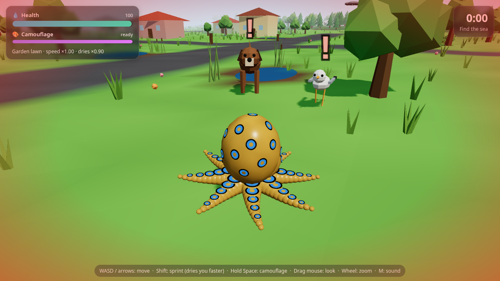

# 🐙 Blue-Ringed Octopus: Run to the Sea

A third-person 3D browser game (Three.js). You are a tiny **Australian blue-ringed octopus** (*Hapalochlaena*), stranded far inland and slowly drying out in the sun. The ocean is somewhere out there – **in a random direction every game, with no compass** – and you have to find your way back to it across an open world of gardens, roads, meadows, forests, mud, rocky hills, dunes and tidal flats.

> Status: **initial concept / prototype (v0.1)** – built to be played, poked at and adjusted.
> No login, no server, no accounts. The repo is private.



## How to run it

### Option 1 – zero install (just double-click)
Open **`play/index.html`** in any modern browser (Chrome, Edge, Firefox, Safari). It is one self-contained file – no server, no Node, no internet needed.
* Windows: double-click **`Play.bat`** (or `play\index.html`). macOS/Linux: `./play.sh`.

### Option 2 – developer mode (live reload)
Needs [Node.js 18+](https://nodejs.org).
```bash
npm install
npm run dev          # opens http://localhost:5173
```
Windows shortcut: double-click **`Dev.bat`** (installs on first run, starts the server, opens the browser).

### Option 3 – Visual Studio / VS Code
* **Visual Studio 2022:** *File ▸ Open ▸ Folder…* and pick this folder. Open `package.json`, right-click it ▸ **Open npm Scripts** (or use *View ▸ Terminal*) and run `npm install`, then `npm run dev`. Browse to http://localhost:5173. (You can also just right-click `play/index.html` ▸ *Open With ▸ Browser*.)
* **VS Code:** *File ▸ Open Folder…*, then *Terminal ▸ Run Task…* ▸ **Run game (dev server)**. A launch config for Edge is included.

### Rebuilding the single-file version
```bash
npm run build        # writes play/index.html (committed so Option 1 always works)
npm run build:dist   # normal multi-file build into dist/ (for hosting on any static server)
```
`play/index.html` is committed on purpose. GitHub Pages is **not** enabled: Pages on a *private* repository needs a paid GitHub plan. If you ever want a shareable link, either upgrade, make a public copy, or drop `dist/` on any static host (Netlify, Cloudflare Pages, S3, …).

## Controls
| Action | Keys |
|---|---|
| Move (relative to the camera) | **W A S D** or **arrow keys** |
| Sprint (dries you out 2× faster) | **Shift** |
| Camouflage (hold) | **Space**, **C** or **E** |
| Look around | **drag with the mouse** |
| Zoom | **mouse wheel** |
| Mute / unmute | **M** |
| Restart after the game ends | button, or **R** |

Touch screens get an on-screen joystick, RUN and CAMO buttons; drag anywhere else to look.
URL options: `?seed=1234` (fixed first world), `?debug=1` (fps / position / distance-to-sea overlay), `?shadows=0` (faster on weak GPUs), `?autostart=1` (skip the title screen).

## How to play
* **Health = hydration.** It drains constantly. Wade into **puddles, streams, ponds, tide pools, dripping taps and rock seeps, garden sprinklers and drifting rain showers** to recover. Standing in water pauses drying.
* **Terrain matters.** Each ground type changes your speed and how fast you dry (shown on the HUD):

  | Terrain | Speed | Dries |
  |---|---|---|
  | Garden lawn / meadow grass | ×1.0 | ×0.9 – 1.0 |
  | Forest floor | ×0.85 | ×0.7 |
  | Squelchy mud | ×0.55 | ×0.45 |
  | Sun-baked rock | ×0.8 | ×1.5 |
  | Dry scrub | ×0.95 | ×1.6 |
  | Hot asphalt (roads) | ×1.15 | ×2.2 |
  | Dry sand / dunes | ×0.7 / ×0.6 | ×1.9 / ×2.1 |
  | Wet tidal flat | ×0.85 | ×0.4 |
* **Predators** roam each habitat: **seagulls** (beach & town), **cats** and **dogs** (gardens & meadows), **foxes** (forest & scrub), **crabs** (shore) and **eagles** (soaring overhead, they dive), plus **people** in town. Each notices you from a different distance – moving and sprinting is noisier than staying still – and chases and attacks, draining health.
* **Camouflage:** hold Space. Over ~½ s your body takes on the colour of the ground you are on and the blue rings fade away. You freeze while hidden. A predator that was after you gets confused (`?`), then wanders off. Catches:
  * It uses a **camo energy** meter and has a **cooldown** – run it dry and you can't hide until it recovers.
  * Hiding makes you dry **25 % faster**.
  * Predators with a good nose won't be fooled **at close range** (dog ≈ 5.5 m, fox ≈ 3.5 m, cat ≈ 2.5 m, crab ≈ 1.5 m). Hide *early*, not under its nose.
* **The warning display:** like the real animal, your **electric-blue rings flash** when a predator has noticed you – that's your cue to hide or run.
* **Finding the sea (no compass).** Subtle clues: the ground slowly turns to sand and dunes, gulls and the surf get louder, the horizon haze turns pale turquoise, a faint sea breeze carries salt-spray specks inland, and streams tend to meander toward the coast. Turn individual hints off in `src/config.js`.
* **Win:** wade into the sea → "You made it to the sea!" with your time. **Lose:** at 0 health the octopus stops moving and a **Restart game** button appears (a new world with a new sea direction; "Retry this same world" repeats the seed).

## Features
* Procedural open world (seeded) – heightmap terrain, 10 terrain types, irregular coastline, tidal flats and a shallow sea.
* Blue-ringed octopus built from primitives: mottled ochre body, 8 animated arms, ~80 iridescent blue rings with black outlines, rings glow/flash on alarm and fade under camouflage, body pales and slumps as it dries out.
* 7 predator species with a small state machine (wander → alert → chase → attack → confused → leave); eagles circle and dive.
* Water scenarios: puddles, ponds, streams, tide pools, drips/seeps, sprinklers, rain clouds.
* Low-poly style with fog, shadows, sky dome, clouds, drifting rain, particles and procedural WebAudio sound (wind, surf, gulls, splash, alerts).
* HUD: health, camo meter, terrain readout, timer, toasts, danger vignette. Win and lose screens. Touch support.

## Tweaking the game
Everything tunable is in **`src/config.js`**: world size, drying rate, sprint cost, camo energy / cooldown / dry multiplier, water amounts and refill rates, predator counts and global damage (`damageMult: 0` = peaceful stroll), hints, graphics (tree/grass counts, fog, shadows) and the terrain table (colour, speed, dry multiplier). Predator species stats (speed, notice distance, damage, camo "pierce" range) are at the top of `src/entities/predators.js`.

## Project layout
```
index.html            page + HUD markup           src/config.js       all tunables
src/main.js           bootstrap                   src/game.js         game state, camera, win/lose, loop
src/world/worldData.js  pure world generator      src/world/worldView.js  terrain/sea/water/decor rendering
src/world/models.js   low-poly model helpers      src/entities/octopus.js  player model & rules
src/entities/predators.js  species + AI           src/audio.js, input.js, hud.js, debug.js
scripts/unit.mjs      world-generator checks      scripts/smoke.mjs   headless browser test
play/index.html       built single-file game      vite.config.js      build (single-file plugin)
```

## Tests
```bash
npm run unit     # world generator: sea always reachable, water variety, determinism … (no browser)
npm run smoke    # headless Chrome/Edge: loads play/index.html over file://, no console errors, render loop,
                 # predators notice + rings flash + camo makes them leave, lose/restart, win, new sea direction
npm test         # unit + build + smoke   (set CHROME_PATH if Chrome/Edge isn't auto-detected)
```
The page exposes `window.__game` (`setHealth`, `teleportToOcean`, `spawnPredator`, `advance`, …) for tests and console tinkering.

## Known limitations / ideas for next iteration
* Prototype art: all models are primitives; animation is simple. Predator legs/gaits are basic.
* No minimap/compass by design – but there's also no way to "learn" the world between runs; ideas: a field journal, discoverable landmarks.
* Water collisions are circles and terrain carving is coarse (2.5 m grid), so puddle edges are a bit faceted.
* Balance numbers are first guesses (a straight dash without water kills you ~20 m short of the sea). Needs playtesting – tweak `src/config.js`.
* Ideas: day/night and heat waves, tides, hiding under rocks/seaweed for a camo bonus, venom bite as a last-ditch defence, more predators (snakes, crows, cars), difficulty modes, scoring/leaderboard, save/seed sharing, controller support, better sound, mobile polish, a proper menu/settings, optional login later.
